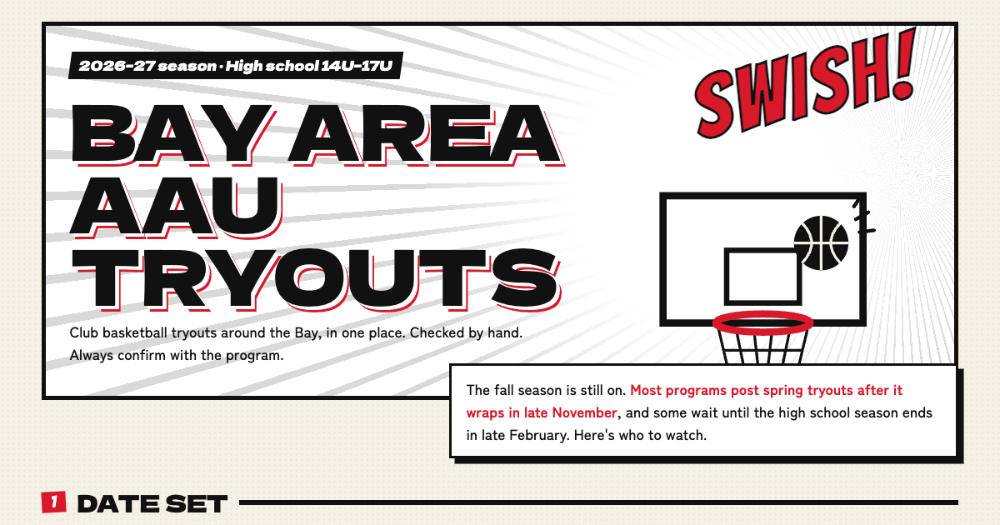

# Bay Area AAU Tryouts

High school (14U–17U) AAU and club basketball tryouts around the San Francisco Bay Area, in one place, drawn like a sports-manga page. Every listing is checked by hand against the program's own site, flyer or sign-up form.

**Live:** https://aau-basketball-tryouts.vercel.app



- **17 programs** across SF, the Peninsula, the East Bay and the South Bay, grouped as *Date set*, *Coming soon* and *Not announced yet*, with filters for boys/girls, area and age.
- Programs that don't say boys or girls, or which age groups they field, are labelled that way and stay visible under every filter rather than being guessed.
- A tryout date that has passed is marked "Already happened" in the visitor's own day.
- Where it's known, each card says when the program held tryouts last season, clearly labelled as last year.
- Not every Bay Area program is listed; "Suggest a program" and "Report a change" open a GitHub issue.

Not affiliated with any program or with any manga.

## Keeping it current

Most programs post spring tryouts after their fall season ends (late November), and some after the high school season (late February). From December to February the list is re-checked **every week**; a reminder posts in Discord on Mondays.

Each update:

1. Run `npm run check-links` to find links that stopped loading.
2. For each program, open its site and sign-up form and look for spring tryout news. Only record a date, time, place or fee that the program itself has posted for this season; otherwise keep it "not announced". Never carry an old date forward.
3. Edit `src/data/programs.json` (status `set` / `soon` / `tba`, the `tryout` block, the plain-English `note`, `lastSeason`, `sources`) and bump `checked`.
4. `npm run build`, open a pull request, merge, and Vercel deploys it.

## Develop

```sh
npm install
npm run dev           # http://localhost:4321
npm run build         # static files in dist/
npm run check-links   # every program link, sign-up form and source
npm run brand         # favicon set + share image (needs Chrome; see the script header)
```

`src/pages/index.astro` is the page (markup, styles and the small filter script); `src/data/programs.json` is the data. It's a static [Astro](https://astro.build) site on Vercel with Vercel Web Analytics.

## License

Apache License 2.0. Fonts: Dela Gothic One, Bangers and Zen Kaku Gothic New (SIL Open Font License).
